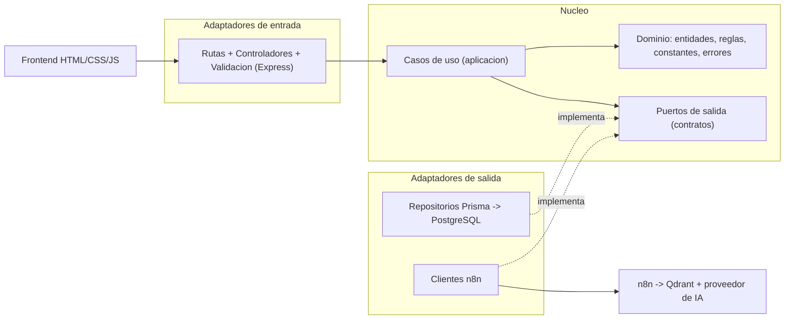

# Arquitectura hexagonal (puertos y adaptadores)

El nucleo (dominio + casos de uso) no conoce Express, Prisma ni n8n. Todo lo externo entra o sale por **puertos** y se implementa en **adaptadores**.

## Capas y carpetas (`backend/src`)
| Capa | Carpeta | Regla |
|---|---|---|
| Dominio | `dominio/` (entidades, constantes, reglas, errores) | No importa nada externo |
| Aplicacion | `aplicacion/casosDeUso/`, `aplicacion/puertos/salida/` | Solo depende del dominio y de los puertos |
| Adaptadores de entrada | `adaptadores/entrada/http/` (rutas, controladores, esquemasValidacion, middlewares) | Traduce HTTP a casos de uso; sin logica de negocio |
| Adaptadores de salida | `adaptadores/salida/persistencia/prisma/`, `adaptadores/salida/orquestadorN8n/` | Implementan los puertos |
| Configuracion | `configuracion/` | Variables de entorno y raiz de composicion |

## Flujo de una peticion
`Ruta -> validarEsquema (DTO) -> Controlador -> Caso de uso -> Puerto -> Adaptador (Prisma o n8n)`

## Reglas de dependencia
1. El dominio no importa de ninguna otra carpeta.
2. Los casos de uso importan solo del dominio y de `puertos/salida`.
3. Los adaptadores importan puertos y dominio, nunca otros adaptadores.
4. Solo `configuracion/contenedorDependencias.js` conoce todas las piezas.
5. El frontend solo llama al backend. n8n y Qdrant nunca se llaman desde el frontend, y el backend solo llama a Qdrant a traves de n8n.

## Como agregar una funcionalidad nueva
1. Regla o constante en `dominio/` (si aplica).
2. Metodo en el puerto (si necesita datos o un servicio externo).
3. Caso de uso en `aplicacion/casosDeUso/<grupo>/casoDeUso<Nombre>.js`.
4. Implementar el metodo en el adaptador de salida.
5. Esquema de validacion, controlador y ruta.
6. Registrar todo en `contenedorDependencias.js` y en `aplicacion.js`.
